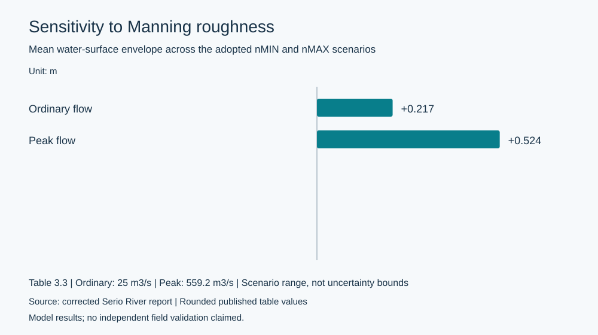
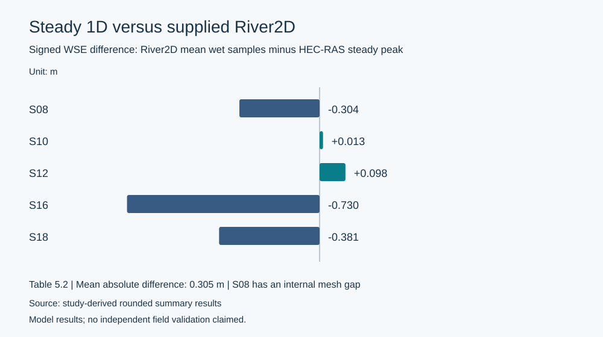

# Lower Serio River | Computational Hydraulic Modelling

**HEC-RAS 1D steady and unsteady analysis · numerical sensitivity · Python post-processing · comparison with a supplied River2D result**

This engineering portfolio documents the analytical work performed for an academic study of approximately **14.3 km** of the lower Serio River in Lombardy, Italy. It demonstrates hydraulic scenario analysis, flood-wave routing, computational quality checks, and scientific programming.

**Publication scope:** The original river geometry, supplied hydrograph, course models, River2D mesh and results, photographs, imagery and the full academic report are **not distributed** here. The repository shares analysis code, original summary graphics, selected derived indicators, methodology, and engineering interpretation. It is not a complete hydraulic-model distribution.

## Engineering highlights

| Analysis | Selected model result |
|---|---|
| 1D steady scenarios | 25 m³/s ordinary flow and 559.2 m³/s 200-year peak-flow scenario |
| Peak-flow Manning sensitivity | Mean nMAX–nMIN water-surface envelope: **0.524 m**; maximum **0.850 m** at XS6 |
| Unsteady routing benchmark | **50 m** nominal section spacing; **2 s** computational time step (U50_2s) |
| Flood-wave routing | **559.17 → 533.14 m³/s** peak discharge; **4.65%** attenuation; **5.96 h** peak delay |
| 1D–2D water levels | **0.305 m** mean absolute WSE difference over five representative sections |
| Model-quality caveat | Supplied 2D boundary-flow readouts differ by **3.53%**, reason unverified |

These are **simulation results, not observed measurements or field-validated predictions**. The 2D solution was supplied; our contribution was its extraction, processing, numerical checking, and comparison with the 1D results.

*Original SVG visualizations generated from selected rounded, derived summary values. They do not reproduce any course map or model geometry.*

## What the project demonstrates

- **Hydraulic modelling:** 1D steady water-surface profiling, ordinary/peak discharge scenarios, bridge-zone diagnostics, and levee representation.
- **Numerical sensitivity:** section-specific Manning roughness scenarios, boundary-condition assessment, 50 m/100 m unsteady discretization, and 2 s/5 s/10 s timestep checks.
- **Flood-wave analysis:** transient routing, downstream peak attenuation, delay, and mass/volume-accounting diagnostics.
- **Scientific programming:** archived Python analysis workflows, HDF extraction, River2D cross-section interpolation, visualization, and comparison of hydraulic variables.
- **Technical judgment:** careful distinction among computational checks, model comparison, and observational validation.

## Read the technical case study

- [Portfolio case study](docs/portfolio-case-study.md)
- [Methodology](docs/methodology.md)
- [Quantitative results](docs/results.md)
- [Limitations](docs/limitations.md)
- [Reproducibility and input requirements](docs/reproducibility.md)

## Code and reproducibility

The repository includes all **seven archived Appendix D source listings** in [scripts/archived](scripts/archived/). They were recovered from the non-distributed project report and matched against its SHA-256 digests. Six are analytical workflows requiring the corresponding original input files; the seventh hourly hydrograph interpolation listing is an **incomplete fragment** and is preserved as such.

To reproduce the public **summary charts** with Python 3.10+ (standard library only):

    python scripts/build_summary_figures.py

That command redraws the two supplied SVG charts from the small CSV tables in [data/processed](data/processed/). It **does not run HEC-RAS or River2D** or independently regenerate the reported hydraulic results.

See [code overview](scripts/archived/README.md) and [reproducibility details](docs/reproducibility.md) before running the archived analysis workflows.

## Repository layout

| Path | Contents |
|---|---|
| scripts/archived/ | Seven SHA-256-verified Python source listings |
| scripts/build_summary_figures.py | Independently runnable chart generation |
| data/processed/ | Small, attributed rounded result summaries |
| figures/ | Original SVG result charts |
| docs/ | Portfolio case study, methodology, results, limitations and reproducibility |
| outreach/ | LinkedIn announcement copy and carousel outline |

## Academic provenance and responsible use

The underlying hydraulic geometry, hydrograph and River2D solution were supplied for an academic exercise. Their authorship and ownership are not claimed here. They are intentionally omitted, as are course imagery and the full report. The **MIT license applies only to project-owned code**, not to proprietary software or third-party inputs. Please see [rights and attribution](THIRD_PARTY_NOTICES.md).

**No independent field calibration, flood-hazard validation, erosion prediction, or engineering design certification is claimed.**