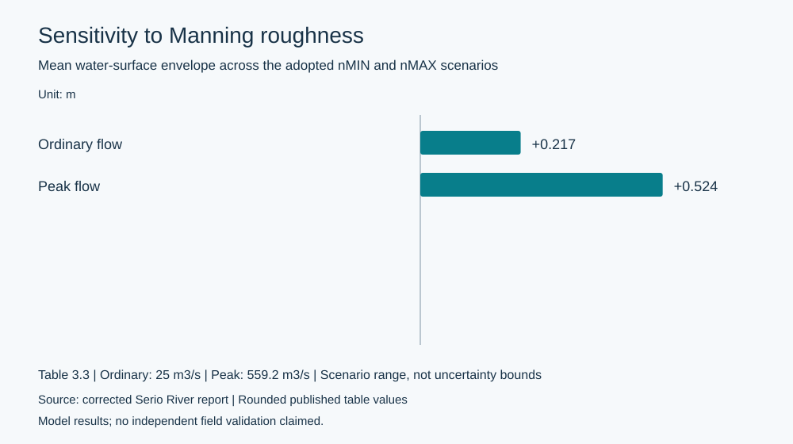
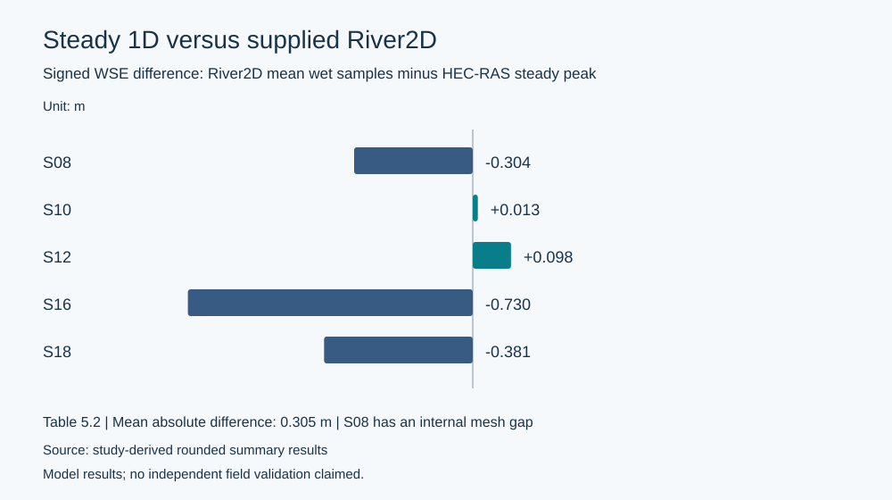

# Engineering case study: Lower Serio River hydraulic modelling

**Scope:** 1D steady and unsteady hydraulic response over approximately 14.329 km, with post-processing of a supplied steady 2D result. **Tools:** HEC-RAS, River2D output data, and Python.

## Engineering problem

How much do hydraulic assumptions change predicted flood-stage profiles, and what additional information is obtained by accounting for temporal flood routing and laterally varying flow?

An academic river-modelling exercise provided geometric/hydrological inputs and a River2D solution for part of the lower Serio River, Lombardy. The analytical work assessed modeling choices, extracted quantitative results, and compared complementary 1D and 2D representations. Source geometry, course materials, and original model files are intentionally excluded from this public portfolio.

## 1. Establishing a steady hydraulic baseline

A 1D HEC-RAS reach of 14.329 km was described by a base geometry of 27 cross sections, including supplementary sections near an explicit bridge at RS6.1 and two adopted levee markers. Model scenarios considered an ordinary discharge of 25 m³/s and a 200-year peak-flow discharge of approximately 559.2 m³/s.

Section-specific Manning roughness was treated as an uncertain hydraulic input: minimum, nominal and maximum scenarios were evaluated, with a separate comparison of normal- and critical-depth boundary formulations. This isolates the influence of a selected input rather than changing roughness and boundary conditions simultaneously.

At peak flow, the mean water-surface-elevation (WSE) difference between nMAX and nMIN was **0.524 m**; the largest local difference was **0.850 m at XS6**. For ordinary flow, the mean envelope was **0.217 m**. Normal-depth boundaries with the maximum adopted roughness scenario were selected as the conservative steady benchmark within these tested scenarios, **not as a calibrated field-derived resistance estimate**.

## 2. Routing a flood hydrograph

The 1D steady model was extended to unsteady conditions using a supplied 200-year inflow hydrograph and a normal-depth downstream boundary (slope 0.0015).

Eight numerical configurations examined two nominal cross-section spacings (50 m and 100 m) and four time steps (2, 5, 10 seconds, and a deliberately coarse 1 hour). The refined runs produced closely matching maximum-WSE profiles; coarse hourly timesteps increased numerical diffusion. The selected U50_2s benchmark had a reported volume-accounting error of **0.000722%**—a numerical diagnostic, not evidence of observational calibration.

For that benchmark, the reported upstream discharge peak was **559.17 m³/s** at 27.00 hours. The downstream peak was **533.14 m³/s** near 32.96 hours. The resulting modelled flood-wave peak attenuation was **4.65%** with a **5.96-hour** delay along the reach. The maximum reported absolute difference between unsteady maximum WSE and the steady peak-flow profile was **1.301 m at XS8**, reflecting different physical/time assumptions.

## 3. Interpreting a supplied River2D solution

A steady River2D peak-flow mesh (6,761 nodes and 13,187 triangular elements) was **supplied as a solved state**, not independently developed and rerun for this analysis. Our 2D contribution was the extraction and checking of bed elevations, water-surface levels, and velocity information along five representative section axes: S08, S10, S12, S16 and S18.

Profiles were sampled at 2 m intervals, distinguishing the sampling interval from the model mesh resolution; samples outside the mesh were excluded rather than extrapolated. Valid wet samples used depth greater than 0.02 m. The HEC-RAS steady peak-level at each comparable section was compared to the River2D mean wet WSE.

The **mean absolute 1D–2D WSE difference was 0.305 m** over the five sections; the largest was **0.730 m at S16**. The 2D velocity profiles revealed laterally concentrated flow, especially at S16 and S18, which a single 1D channel-mean velocity cannot describe.

## 4. Model-quality observations

The displayed 2D boundary-flow readouts were 559.000 m³/s at the inlet and 578.730 m³/s at the outlet, a **3.53% difference**. The cause is not established from the supplied evidence. The 2D computational footprint also did not cover the entire 1D reach; one comparison section (S08) intersected an internal mesh gap.

These caveats are essential: model-to-model agreement is **not field validation**, and the 1D and 2D velocity statistics represent different averaging domains. The project is not a validated flood-hazard map, structural-design recommendation or quantitative erosion-risk assessment.

## 5. Engineering takeaways

Steady 1D analysis is useful for longitudinal water-level and assumption sensitivity; unsteady 1D analysis adds wave timing and attenuation; 2D results add spatial context and lateral velocity variation. Comparing models is most informative when definitions, boundary conditions and numerical limitations are explicit.

This portfolio documents the analysis code, derived findings and interpretation. Original teaching material, source hydrographs and model geometry remain outside the public repository.

**Further reading:** [methods](methodology.md) · [results](results.md) · [limitations](limitations.md) · [reproducibility](reproducibility.md).
