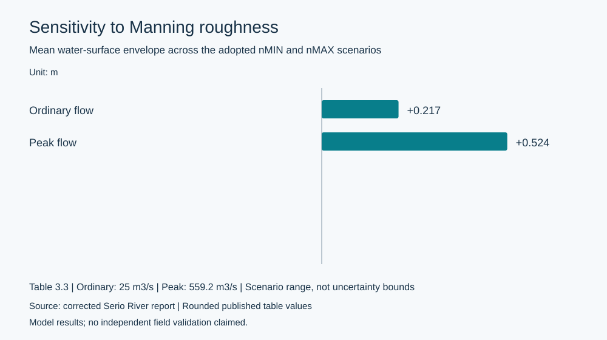
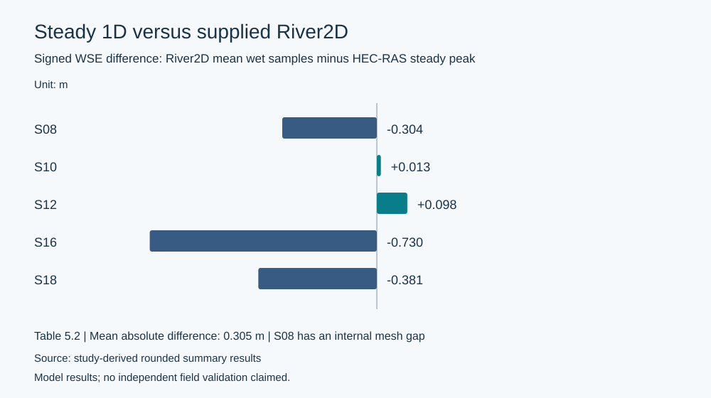

# Quantitative results

**All results below are outputs of numerical model analysis, not observations.** The underlying academic model input files are intentionally not distributed.

| Quantity | Derived / reported result |
|---|---:|
| 1D reach length | 14.329 km |
| Ordinary/peak steady discharges | 25 / 559.2 m³/s |
| Mean nMAX–nMIN WSE envelope: ordinary | 0.217 m |
| Mean nMAX–nMIN WSE envelope: flood peak | **0.524 m** |
| Maximum peak-flow roughness envelope | 0.850 m at XS6 |
| Unsteady benchmark numerical spacing | 50 m and 2 s |
| Benchmark volume-accounting error | 0.000722% |
| Upstream peak flow | 559.17 m³/s at 27.00 h |
| Downstream peak flow | 533.14 m³/s at ~32.96 h |
| Peak attenuation and delay | **4.65% / 5.96 h** |
| Largest steady-vs-unsteady maximum WSE difference | 1.301 m at XS8 |
| Mean absolute 1D–2D WSE difference | **0.305 m** across five sections |
| Largest 1D–2D WSE difference | 0.730 m at S16 |
| Supplied River2D inlet/outlet flow difference | 3.53% (not explained) |

## Manning sensitivity

At peak flow, overbank activation makes roughness sensitivity materially greater than under ordinary discharge. The shown envelope is the span among tested modelling assumptions, **not a statistical confidence interval**.

## Five-section 1D–2D comparison

This figure plots signed differences of River2D mean wet WSE minus the HEC-RAS steady peak WSE. It preserves published rounded summary statistics; for example S10's reported +0.013 m differs by 0.001 m from subtraction of the separately rounded displayed stage values. No accuracy ranking is inferred from model-to-model differences.

River2D flow velocity profiles show strong lateral variation at S16 and S18, but comparison with 1D channel-mean velocity requires caution because the spatial averaging domains differ.

## Interpretation limits

- Without observed flood stages or velocities, the model comparison does not validate predictive accuracy.
- No independent bridge-removal or levee-removal runs isolate causal effects.
- The River2D footprint is shorter than the full 1D reach and S08 contains a mesh gap.
- The displayed River2D outflow exceeds inflow by 19.730 m³/s; its cause remains unknown.
- These outputs do not constitute calibrated flood-extent maps or engineering design certification.
